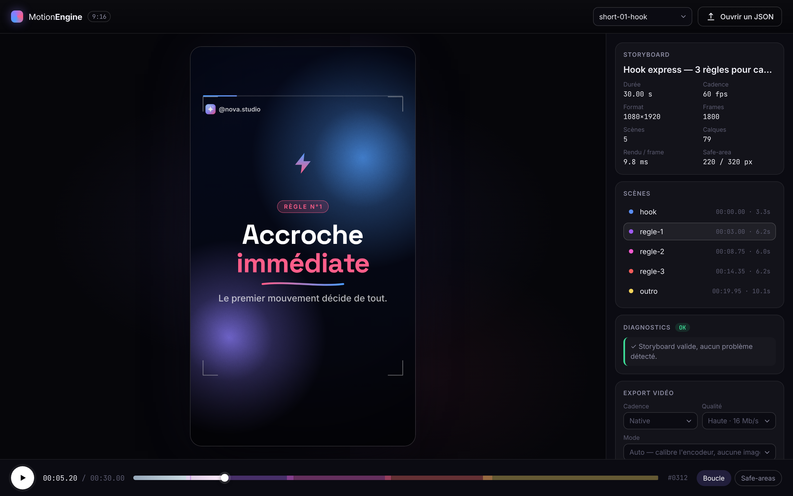
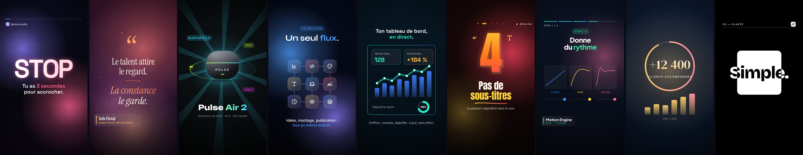

# Motion Engine · 9:16

Moteur de **motion design piloté par un fichier `storyboard.json`**, 100 % navigateur, pensé pour produire des vidéos **TikTok (1080×1920, 9:16)** captivantes :

- **Preview temps réel** dans le navigateur (Canvas 2D, 60 fps).
- **Export WebM** directement depuis le navigateur, **image par image, déterministe**, sans backend.
- **Storyboard validé** avec des erreurs lisibles (chemin JSON exact + suggestion « vouliez-vous dire… »).
- **Composants réutilisables** (`title-card`, `lower-third`, `logo-reveal`), **9 exemples** prêts à l'emploi.





---

## Sommaire

1. [Démarrage rapide](#1-démarrage-rapide)
2. [Utiliser le player](#2-utiliser-le-player)
3. [Architecture & choix techniques](#3-architecture--choix-techniques)
4. [Référence du `storyboard.json`](#4-référence-du-storyboardjson)
5. [Keyframes & easings](#5-keyframes--easings)
6. [Composants](#6-composants)
7. [Export vidéo](#7-export-vidéo)
8. [Exemples fournis](#8-exemples-fournis)
9. [Tests & qualité](#9-tests--qualité)
10. [Limitations connues](#10-limitations-connues)
11. [Roadmap V2](#11-roadmap-v2)

---

## 1. Démarrage rapide

Prérequis : **Node ≥ 22.12** (Vite 8 ; les tests et le générateur d'exemples utilisent l'exécution TypeScript native de Node).

```bash
npm install
npm run dev
```

Ouvrir http://localhost:5173 — l'exemple `short-01-hook` se lance automatiquement.

| Commande | Rôle |
|---|---|
| `npm run dev` | Serveur de dev Vite (HMR) |
| `npm run build` | Typecheck strict + build de production dans `dist/` |
| `npm run preview` | Sert le build de production |
| `npm run typecheck` | `tsc` sur l'app **et** sur les tests/scripts |
| `npm test` | Tests unitaires + vérification du cahier des charges des 9 exemples (`node --test`, zéro dépendance) |
| `npm run examples` | Régénère `src/examples/*.json` depuis `scripts/examples/*.ts` et les valide |

**Dépendances** : aucune dépendance d'exécution. En dev : `vite`, `typescript`, `@types/node` (types seuls, pour typer les tests). Pas de zod : la validation est un mini-validateur maison (voir §3) — plus petit, et surtout capable de messages en français contextualisés.

---

## 2. Utiliser le player

- **Charger un storyboard** : menu des exemples, bouton « Ouvrir un JSON », ou **glisser-déposer** un `.json` n'importe où sur la page. Si le fichier est invalide, le storyboard précédent reste affiché et le panneau *Diagnostics* liste les erreurs avec leur chemin JSON.
- **Lien direct** vers un exemple : `http://localhost:5173/?example=long-06-manifesto`.
- **Scrub** : cliquer/glisser sur la timeline (les segments colorés = les scènes, survol = nom de la scène).
- **Safe-areas** : bouton « Safe-areas » (ou `S`) — hachures sur les zones masquées par l'UI TikTok (220 px en haut, 320 px en bas) + maquette du rail d'actions. Dessiné sur un calque DOM séparé : **jamais exporté**.

| Raccourci | Action |
|---|---|
| `Espace` / `K` | Lecture / pause |
| `←` / `→` | Frame précédente / suivante |
| `Maj` + `←` / `→` | −1 s / +1 s |
| `Début` / `Fin` | Première / dernière frame |
| `L` | Boucle on/off |
| `S` | Safe-areas on/off |

**API de scripting** (console du navigateur, tests automatisés) :

```js
await motionEngine.loadExample('short-02-quote');
await motionEngine.loadText(jsonString, 'mon-storyboard.json');
motionEngine.renderAt(12.5);          // rend la frame à t = 12,5 s, renvoie la durée de rendu (ms)
motionEngine.storyboard();            // modèle normalisé courant
await motionEngine.exportVideo();     // lance l'export avec les réglages du panneau
```

---

## 3. Architecture & choix techniques

```
src/
  engine/
    timeline.ts       horloge déterministe (temps absolu en ms, quantifié à la frame)
    scene-manager.ts  scènes actives à t, ordre de dessin, transitions, chargement/déchargement
    renderer.ts       rendu Canvas 2D d'une frame : fonction pure de t
    easing.ts         bibliothèque d'easings (cubic-bezier, spring analytique, elastic, back…)
    keyframe.ts       pistes de keyframes par propriété + interpolation (nombres, couleurs, gradients, tracés)
    path.ts           parseur SVG complet → cubiques ; bounds, longueur, MORPHING
    color.ts          couleurs, gradients, interpolation de peintures
    text-layout.ts    mise en page du texte (crénage, letter-spacing, split, surlignage, compteurs)
    transitions.ts    fade, slide, zoom, wipe, circle, flash, glitch
    runtime.ts        compilation modèle → structures d'exécution (caches Path2D, pistes…)
    assets.ts         préchargement polices (Google Fonts) + images
  parser/
    schema.ts         tables du schéma + mini-validateur (chemins JSON, suggestions)
    parser.ts         JSON brut → modèle normalisé (défauts, palette, composants, chaînage des scènes)
  components/
    index.ts          registre
    title-card.ts · lower-third.ts · logo-reveal.ts · types.ts · util.ts
  player/
    controls.ts       UI : transport, scrub, panneau, diagnostics, safe-areas, export
    exporter.ts       MediaRecorder + captureStream, frame par frame, retiming + durée WebM
  types/storyboard.ts types d'entrée (JSON) et modèle normalisé
  examples/           9 storyboards JSON
  main.ts · style.css
scripts/              générateur des exemples (outil d'auteur, optionnel)
tests/                tests node:test (parser, moteur, exporter, cahier des charges des exemples)
public/assets/        SVG des exemples (logos, produit, avatars…)
```

**Flux** :

```
storyboard.json ──parse/valide──▶ Storyboard normalisé ──préchargement──▶ Renderer.renderFrame(t)
                                                                              ▲            ▲
                                             Timeline (rAF, temps absolu) ────┘            │
                                             Exporter (frame i → t = i/fps) ───────────────┘
```

**Décisions clés**

- **Canvas 2D + Path2D, pas de SVG DOM animé.** Le storyboard décrit des formes SVG (`d`), mais elles sont rendues dans un canvas : rendu rapide, maîtrisé au pixel, et capturable par `captureStream()`.
- **Déterminisme.** `renderFrame(t)` ne dépend que de `t` : pas de delta de rAF, pas d'état d'animation, aléatoire toujours seedé (grain, glitch, ordre « random »). La preview est quantifiée à la frame : elle montre **exactement** les images que l'export produira (vérifié par hash de pixels).
- **Composants = macros JSON.** Un composant produit des calques ordinaires au parsing ; le renderer n'en connaît aucun. Leur sortie est validée comme le reste.
- **Validation maison plutôt que zod.** ~250 lignes, zéro dépendance, toutes les erreurs remontées en une passe, messages en français avec chemin (`scenes[2].layers[0].keyframes[1].easing`) et suggestion par distance de Levenshtein.
- **Modèle normalisé.** Le moteur ne voit jamais de JSON brut : couleurs parsées, `$palette` résolues, débuts de scène calculés, composants expansés.

---

## 4. Référence du `storyboard.json`

### Exemple minimal

```json
{
  "meta": { "width": 1080, "height": 1920, "fps": 60, "background": "#0a0a0f", "safeArea": { "top": 220, "bottom": 320 } },
  "theme": { "palette": { "primary": "#4f9cff", "accent": "#ff5e8a", "text": "#ffffff" }, "fonts": ["Space Grotesk", "Inter"] },
  "assets": { "logo": "./assets/logo-nova.svg" },
  "scenes": [
    {
      "id": "intro",
      "duration": 5,
      "transitionOut": { "type": "fade", "duration": 0.3 },
      "layers": [
        {
          "id": "title", "type": "text", "content": "Bienvenue",
          "font": "Space Grotesk", "size": 120, "weight": 700, "color": "$text",
          "anchor": { "x": 540, "y": 960 },
          "keyframes": [
            { "t": 0, "opacity": 0, "y": 40, "scale": 0.9 },
            { "t": 0.6, "opacity": 1, "y": 0, "scale": 1, "easing": "spring" }
          ]
        }
      ]
    }
  ]
}
```

### Améliorations apportées au schéma d'origine

| Point | Choix |
|---|---|
| `scenes[].start` | **Optionnel** : par défaut, une scène suit la précédente ; le chevauchement = durée des transitions (sortie de l'une / entrée de l'autre). Un `start` explicite reste possible (ex. scène de fond de 40 s sous les autres). |
| `meta.duration` | **Optionnel** : calculé (fin de la dernière scène). Avertissement si incohérent. |
| Temps des keyframes | Relatifs au **début du calque** (`start`), lui-même relatif à sa scène (ou au début de la vidéo pour les `overlays`). |
| `x`, `y` des keyframes | **Décalages** par rapport à `anchor`. |
| `easing` d'une keyframe | S'applique au segment qui **arrive** sur cette keyframe. |
| Couleurs | Références de palette `"$accent"` et variante alpha `"$accent/40"` (40 %). |
| Easings | Paramétrables : `"spring(200,14)"`, `"back(2.4)"`, `"elastic(1,0.4)"`… |
| Ajouts | `pivot`, `split` (lettres / mots / lignes / typewriter / masque), `value` + `{value}` (compteurs), `d` animable (morphing), `pathLength` (traits qui se dessinent), `shape` (rect/circle/star…), `transitionIn`, `overlays`, `blend`, `shadow`, `meta.grain`. |

### `meta`

| Clé | Type | Défaut | Description |
|---|---|---|---|
| `title` | string | `"Sans titre"` | Nom (utilisé pour le fichier exporté) |
| `width`, `height` | entier | 1080, 1920 | Résolution (16–4096) |
| `fps` | entier | 60 | 1–120 |
| `duration` | nombre | calculé | Durée totale (s) |
| `background` | peinture | `#0a0a0f` | Fond global (couleur ou gradient) |
| `safeArea` | `{top,bottom,left,right}` | 220 / 320 / 0 / 0 | Zones d'UI TikTok (debug + lint) |
| `grain` | 0–1 | 0 | Grain filmique (4 tuiles de bruit seedées, 24 tirages/s) |

### `theme`, `assets`

- `theme.palette` : `{ "nom": "#couleur" }` — utilisables partout via `"$nom"` ou `"$nom/NN"`. Défauts fournis : `primary`, `accent`, `text`, `background`.
- `theme.fonts` : familles **Google Fonts** préchargées. Les polices réellement utilisées par les textes (famille + graisse + italique) sont détectées et chargées automatiquement ; le rendu ne démarre qu'une fois tout chargé.
- `assets` : `{ "clé": "url" }`, référencées dans `src` par `"@clé"`. Les URL relatives sont résolues depuis la page (`public/` en dev/build).

### `scenes[]`

| Clé | Type | Description |
|---|---|---|
| `id` | string | Identifiant (affiché dans le player) |
| `duration` | nombre > 0 | **Obligatoire** |
| `start` | nombre | Optionnel (voir chaînage ci-dessus) |
| `background` | peinture | Fond plein écran de la scène (sinon transparente) |
| `transitionIn` / `transitionOut` | transition | `"fade"` ou `{ "type", "duration", "easing" }` |
| `layers` | calque[] | Dessinés dans l'ordre (le dernier au-dessus) |

**Transitions** : `fade`, `slide-up`, `slide-down`, `slide-left`, `slide-right`, `zoom`, `wipe-up`, `wipe-down`, `wipe-left`, `wipe-right`, `circle`, `flash`, `glitch` (défaut : 0,4 s, `ease-in-out-cubic`). Pendant un chevauchement, une scène en **sortie** est dessinée au-dessus : elle « s'efface » pour révéler la suivante. Même type en sortie + entrée = push continu (ex. deux `slide-up`).

**`overlays[]`** (racine) : calques dessinés au-dessus de toutes les scènes, temps absolu — barre de progression, signature, lower-third persistant…

### Propriétés communes à tous les calques

| Clé | Défaut | Description |
|---|---|---|
| `id` | auto | Identifiant |
| `type` | — | `text`, `path`, `image`, `group`, `component` |
| `anchor` (alias `position`) | centre (text/image), sinon = pivot | Position du calque |
| `pivot` | `{0,0}` | Point local de scale/rotate ; `"center"` = centre des bounds |
| `start` / `end` | 0 / — | Fenêtre de visibilité (s, relative au parent) ; les keyframes sont relatives à `start` |
| `x`, `y`, `scale`, `scaleX`, `scaleY`, `rotate`, `opacity`, `clipProgress` | 0,0,1,1,1,0,1,1 | Valeurs statiques (si non animées) |
| `keyframes` | `[]` | Voir §5 |
| `clipDirection` | `left-to-right` | `right-to-left`, `top-to-bottom`, `bottom-to-top`, `center-x`, `center-y`, `center` |
| `clipRect` | bounds | Rectangle de clip local explicite (masque permanent si présent) |
| `blend` | `normal` | `add`, `screen`, `multiply`, `overlay`, `difference`, `soft-light`… |
| `shadow` | — | `{ color, blur, x, y }` (glow si coloré, sans décalage) |

Transformation appliquée : `translate(anchor + (x, y)) · rotate · scale · translate(−pivot)`.

### `text`

| Clé | Défaut | Description |
|---|---|---|
| `content` | — | Texte. `\n` = retour ligne, `*mot*` = surlignage (couleur `highlight`), `\*` = astérisque, `{value}` = compteur |
| `font`, `size`, `weight`, `italic` | 1re police du thème, 64, 700, false | |
| `color` (alias `fill`) | `$text` | Couleur **ou gradient** |
| `stroke`, `strokeWidth` | none, 2 si stroke | Texte en contour |
| `align`, `verticalAlign` | `center`, `middle` | `left`/`right`, `top`/`bottom` |
| `letterSpacing`, `lineHeight`, `maxWidth` | 0, 1.15, — | Retour à la ligne automatique si `maxWidth` |
| `highlight` | `$accent` | Peinture des `*mots*` |
| `value`, `decimals`, `thousandsSeparator`, `decimalSeparator` | 0, 0, `""`, `"."` | Compteurs (`value` animable) |
| `split` | — | Animation par unités, voir ci-dessous |

**`split`** — raccourcis `"chars"`, `"words"`, `"lines"`, `"typewriter"`, ou objet :

| Clé | Défaut | Description |
|---|---|---|
| `by` | `char` | `char`, `word`, `line` |
| `mode` | `stagger` | `typewriter` : apparition instantanée + curseur |
| `start`, `stagger`, `duration` | 0, selon `by`, 0,6 | Temps (s) |
| `easing` | `cubic-bezier(0.16,1,0.3,1)` | |
| `order` | `forward` | `reverse`, `center` (du milieu vers les bords), `random` (seedé) |
| `from` | `{opacity:0, y:0.45·size}` | État de départ de chaque unité : `opacity`, `x`, `y`, `scale`, `rotate` |
| `mask` | false | Chaque unité est masquée par sa propre boîte (lignes qui montent « derrière un masque ») |
| `cursor` | true en typewriter | Curseur (plein pendant la frappe, clignotant ensuite) |

### `path`

| Clé | Défaut | Description |
|---|---|---|
| `d` **ou** `shape` | — | Tracé SVG complet (M L H V C S Q T A Z, absolu/relatif) ou forme : `rect` (`x,y,width,height,radius`), `circle` (`cx,cy,r`), `ellipse`, `line`, `polygon` (`points`), `star` (`cx,cy,points,outer,inner,rotation`) |
| `fill` | `$text` si pas de stroke | Couleur, gradient ou `"none"` |
| `stroke`, `strokeWidth` | none, 2 | Peinture du trait (gradient possible) |
| `lineCap`, `lineJoin`, `fillRule` | round, round, nonzero | |
| `strokeDasharray`, `strokeDashoffset` | —, 0 | Pointillés |
| `pathLength` | — | Longueur virtuelle (comme en SVG). Seul ⇒ dasharray `[L, L]` : animer `strokeDashoffset` de `L` à `0` **dessine le trait** |

### `image`

`src` (URL, data-URI ou `"@asset"`), `width` / `height` (une seule ⇒ ratio conservé ; alias `size: {width, height}`). L'image est centrée sur `anchor`.

### `group`

`layers` : calques enfants, transformés et animés en bloc. L'opacité du groupe est multipliée sur ses enfants.

### `component`

`ref` (nom dans le registre) + `props`. Toutes les propriétés communes s'appliquent à l'instance (elle devient un groupe). Voir §6.

### Peintures (couleurs & gradients)

```json
"#ff5e8a"            "rgba(255,94,138,0.5)"     "hsl(340 100% 68%)"     "$accent"     "$accent/40"
{ "type": "linear", "angle": 135, "stops": [["$primary", 0], ["$accent", 1]] }
{ "type": "linear", "from": {"x":0,"y":0}, "to": {"x":1080,"y":0}, "stops": [...] }
{ "type": "radial", "center": {"x":540,"y":900}, "radius": 600, "stops": [["$accent/60", 0], ["$accent/0", 1]] }
```

`"gradient"` est un alias de `"linear"`. Angle CSS : 0° = vers le haut, 180° = vers le bas (défaut). Les gradients sont calculés sur les **bounds locales** du calque.

---

## 5. Keyframes & easings

```json
"keyframes": [
  { "t": 0,   "opacity": 0, "y": 60, "scale": 0.8 },
  { "t": 0.6, "opacity": 1, "y": 0,  "scale": 1, "easing": "spring(220,13)" },
  { "t": 3,   "fill": "$accent" },
  { "t": 3.5, "fill": { "type": "linear", "angle": 90, "stops": [["$primary",0],["$accent",1]] }, "easing": "ease-in-out" }
]
```

- **Pistes indépendantes** : chaque propriété n'est interpolée qu'entre les keyframes qui la définissent.
- Avant la 1re clé / après la dernière : la valeur est **tenue**.
- L'`easing` d'une clé s'applique au segment **qui y arrive**. Défaut : `ease-in-out`.

**Propriétés animables**

| Propriété | Calques | Interpolation |
|---|---|---|
| `x`, `y`, `scale`, `scaleX`, `scaleY`, `rotate`, `opacity`, `clipProgress` | tous | numérique (opacité/clip bornés à [0,1]) |
| `fill` (alias `color`), `stroke` | text, path | couleur ↔ couleur, couleur ↔ gradient, gradient ↔ gradient (mêmes stops) |
| `strokeWidth` | text, path | numérique |
| `strokeDashoffset` | path | numérique (unités `pathLength` si défini) |
| `value` | text | numérique → `{value}` |
| `d` | path | **morphing** : tracé SVG ou `shape` ; formes appariées automatiquement (même nombre de segments, départ et sens alignés) |

**Easings**

| Syntaxe | Effet |
|---|---|
| `linear` | Vitesse constante (dérives, timers) |
| `ease`, `ease-in`, `ease-out`, `ease-in-out` | Courbes CSS standard |
| `ease-{in,out,in-out}-{quad,cubic,quart,quint,expo,circ}` | Familles classiques (`ease-out-expo` = arrivée très nerveuse) |
| `cubic-bezier(x1,y1,x2,y2)` | Courbe sur mesure (x ∈ [0,1]) — `cubic-bezier(0.16,1,0.3,1)` est un excellent « out » premium |
| `spring` · `spring(stiffness, damping[, mass])` | Ressort résolu analytiquement, défaut `spring(170,12)`. Raide = nerveux, peu amorti = rebonds |
| `elastic` · `elastic(amplitude, period)` · `elastic-in` · `elastic-in-out` | Oscillation élastique (défaut `elastic(1,0.35)`) |
| `back` · `back(overshoot)` · `back-in` · `back-in-out` | Léger dépassement (défaut 1.70158) ; `back-in` = anticipation avant sortie |
| `steps(n)` · `hold` | Sauts nets (comptes à rebours, compteurs d'étapes) |

Forme objet acceptée : `{ "type": "spring", "stiffness": 200, "damping": 14 }`.

> **Spring & durée** : le ressort est simulé jusqu'à son temps d'établissement, puis étiré sur la durée du segment. Un segment court = un ressort plus nerveux.

**Conseils TikTok** : entrées en 0,4–0,8 s avec `spring`/`back`/`cubic-bezier(0.16,1,0.3,1)` ; sorties en 0,3–0,4 s avec `ease-in`/`back-in` ; dérives de fond en `linear` sur toute la scène ; une idée = un mouvement.

---

## 6. Composants

Les composants sont des **macros** : `props` validées → calques JSON → parsing normal. Les props sont typées (`string`, `number`, `boolean`, `color`, `enum`) : une faute de frappe dans un nom de prop ou une valeur d'enum est signalée avec suggestion.

```json
{ "type": "component", "ref": "title-card", "start": 0.3,
  "props": { "kicker": "Règle n°1", "title": "Accroche\n*immédiate*", "style": "rise", "exit": 5.5 } }
```

### `title-card`

Titre animé : pastille de sur-titre, titre (split), soulignement qui se dessine, sous-titre, sortie optionnelle.

| Prop | Défaut | |
|---|---|---|
| `title` | **requis** | `\n`, `*accent*` |
| `subtitle`, `kicker` | — | |
| `style` | `rise` | `rise` (lettres qui montent, spring), `pop` (mots, back), `typewriter`, `mask` (lignes masquées) |
| `x`, `y`, `align` | centre de la zone sûre, `center` | `align: left` ⇒ `x` = bord gauche |
| `size`, `weight`, `font`, `maxWidth` | 112, 700, police 1, 900 | |
| `subtitleFont`, `subtitleSize`, `subtitleColor` | police 2, 44, `$text/70` | |
| `color`, `accent`, `accent2` | `$text`, `$accent`, `$primary` | |
| `underline` | true | |
| `exit` | — | Instant (s) de sortie (fondu + montée, `back-in`) |

### `lower-third`

Bandeau nom + rôle en verre dépoli, au-dessus de la zone d'UI basse.

| Prop | Défaut | |
|---|---|---|
| `name` | **requis** | |
| `role` | — | Affiché en capitales, couleur d'accent |
| `x`, `y`, `width` | 64 px, au-dessus de la safe-area basse, estimée | |
| `size`, `font`, `roleFont` | 52, police 1, police 2 | |
| `color`, `accent`, `panel` | `$text`, `$accent`, verre | |
| `duration` | — | Si absent : reste affiché |

### `logo-reveal`

Halo, double anneau dessiné en sens opposés, étincelles radiales, logo en ressort, nom (lettres depuis le centre) et baseline.

| Prop | Défaut | |
|---|---|---|
| `src` | — | Image du logo (`"@logo"`) ; sinon pastille dégradée |
| `text`, `tagline` | — | |
| `x`, `y`, `size`, `textSize` | centre, 44 % H, 260, 104 | |
| `font`, `taglineFont`, `color` | police 1, police 2, `$text` | |
| `accent`, `accent2`, `sparks` | `$accent`, `$primary`, 12 | |

### Créer un composant

```ts
// src/components/badge.ts
import type { ComponentDefinition } from './types.ts';

export const badge: ComponentDefinition = {
  name: 'badge',
  description: 'Pastille qui rebondit.',
  props: {
    label: { type: 'string', required: true, description: 'Texte' },
    color: { type: 'color', default: '$accent', description: 'Couleur' },
  },
  expand(p, ctx) {
    return [{ type: 'text', id: `${ctx.id}/label`, content: String(p.label), color: String(p.color),
              keyframes: [{ t: 0, scale: 0 }, { t: 0.6, scale: 1, easing: 'back' }] }];
  },
};
```

Puis l'ajouter à la liste dans `src/components/index.ts`. `ctx` fournit `width`, `height`, `safeArea`, `fonts` et l'`id` d'instance.

---

## 7. Export vidéo

**Principe** (`src/player/exporter.ts`) :

1. `canvas.captureStream(0)` : flux en capture **manuelle**.
2. Pour chaque frame `i` : attente de son créneau d'émission, `renderFrame(i / fps)` (temps virtuel **exact**), `track.requestFrame()`, puis on **cède une frame d'affichage** (Chrome capture le canvas à la peinture : sans cette pause, une frame redessinée trop tôt n'est jamais capturée). Le rythme est **relatif** : après un retard, pas de rafale de rattrapage.
3. `MediaRecorder` encode (`video/webm;codecs=vp9`, repli `vp8`, puis MP4 sur Safari) au débit choisi (8 / 16 / 25 Mb/s).
4. **Retiming** : MediaRecorder horodate à la réception (gigue, décalage initial, frame de pré-roll). Après coup, chaque bloc du WebM est réaligné sur son temps idéal `i/fps` (alignement par programmation dynamique entre instants de capture et d'émission). Les images éventuellement jetées par l'encodeur sont **comptées**.
5. **Durée WebM** : Chrome n'écrit pas la durée (fichier non « seekable ») ; elle est injectée dans l'en-tête EBML.

Le contenu de chaque image ne dépend que de `i` : la vidéo est identique d'une machine à l'autre.

**Pourquoi un mode Auto ?** Quand le pipeline capture → encodeur du navigateur sature, Chrome ne ralentit pas : il **jette** la majorité des images. Le débit soutenable dépend de la machine *et du contenu* (dégradés plein écran, grain filmique… sont coûteux à encoder). Mesuré dans un conteneur Linux sans GPU sur un extrait de `short-02` : rythme ×2 avec l'ancienne boucle → 25 images sur 480 ; ×4 → 480/480. Le mode **Auto** (défaut) :

1. **calibre** l'encodeur : 4 rafales de 15 frames consécutives réparties dans la vidéo, encodées à ×1, ×2, ×4, ×8 ; le premier rythme sans perte est retenu (quelques secondes) ;
2. **exporte** à ce rythme ;
3. **vérifie** : si des images ont malgré tout été jetées (comptées grâce au retiming), il recommence automatiquement deux fois plus lentement.

**Modes et cadence**

| Réglage | Durée d'export pour 60 s de vidéo | Usage |
|---|---|---|
| **Auto** (défaut) | 60 s à ~2 min sur une machine récente, + calibrage | Recommandé : le plus rapide **sans perte** pour cette machine et ce contenu |
| Temps réel | ≈ 60 s | Machine puissante, quand on connaît sa marge |
| Sûr — 2× | ≈ 120 s | Rythme fixe |
| Très sûr — 4× | ≈ 240 s | Machine modeste / contenu très lourd |
| Cadence 30 fps | moitié moins d'images à encoder | **Export allégé** : divise par deux la charge (donc souvent le rythme retenu par Auto) et la taille du fichier ; mouvement un peu moins fluide |

> MediaRecorder horodate en temps réel : il est **impossible d'exporter plus vite que le temps réel** avec cette API. Les modes lents émettent moins vite puis recompressent les horodatages ; le débit est divisé d'autant pour garder une qualité constante. Si l'export d'une minute de vidéo dépasse ~3 min sur votre machine, passez en **30 fps** : la moitié des images, donc environ moitié moins de temps.

**Pendant l'export** : gardez l'onglet **visible** (un onglet masqué est bridé par le navigateur — l'export le détecte et le signale).

**Publication** : le WebM VP9 est lu partout (Chrome, Firefox, VLC…). Si une plateforme exige du MP4 :

```bash
ffmpeg -i video.webm -c:v libx264 -preset slow -crf 18 -pix_fmt yuv420p video.mp4
```

---

## 8. Exemples fournis

Tous en **1080×1920, 60 fps**, safe-areas TikTok (220 px / 320 px), ≥ 2 composants, les **5 types de calques** et les **8 familles d'easing** (vérifié par `npm test`).

| Exemple | Durée | Composants | Easings mis en avant | Cas d'usage |
|---|---|---|---|---|
| `short-01-hook` | **30,0 s** | title-card, logo-reveal | spring (scale punch), back, elastic, cubic-bezier, ease-out | Hook express : « STOP » + onde de choc, 3 règles (lettres, typewriter + morphing, lignes + égaliseur), logo + CTA, barre de rétention |
| `short-02-quote` | **40,0 s** | title-card ×2, lower-third | ease-in-out (mot par mot), cubic-bezier, linear (fond animé), elastic | Citation inspirante : dégradé animé sur 40 s (scène de fond à `start` explicite), citation mot par mot, autrice en lower-third, fondu final |
| `short-03-promo` | **44,5 s** | title-card ×2, logo-reveal | elastic (produit), spring (cartes), steps(5) (compte à rebours), back | Promo produit : packshot élastique + orbite 3D, 3 bénéfices en cartes, compteur 40 h, compte à rebours 5→0, prix barré, CTA |
| `long-01-brand-story` | **66,0 s** | title-card ×4, logo-reveal, lower-third | spring (rangement), back, elastic, linear (tremblement), cubic-bezier | Brand story : problème (chaos de tuiles) → solution (grille + connexions) → révélation NOVA → 3 bénéfices + témoignage → CTA |
| `long-02-explainer` | **68,0 s** | title-card ×4, logo-reveal, lower-third | ease-in (aspiration), spring, cubic-bezier (traits), ease-out-expo (KPI) | Explainer : capture → kanban automatique → équipe → **démo en dessin au trait** (cadre, grille, barres en clip reveal, courbe, donut, KPI) → outro |
| `long-03-countdown` | **65,0 s** | title-card ×6, logo-reveal | spring, back, elastic (signature d'entrée par rang), cubic-bezier | Top 5 : chiffres géants en contour + remplissage, transitions éclair variées (push, glitch, wipe, zoom, flash), « le fix » |
| `long-04-tutorial` | **70,2 s** | title-card ×6, lower-third (persistant), logo-reveal | linear (tête de lecture), hold (compteur d'étapes), spring, back, elastic | Tutoriel en 5 étapes : code tapé, palette, keyframes sur une piste, **vraies courbes d'easing**, export ; progression + lower-third en overlay |
| `long-05-testimonial` | **68,0 s** | title-card, lower-third ×3, logo-reveal | ease-in-out (citations), ease-out-expo (compteur 12 400), cubic-bezier, elastic (étoiles) | Social proof : citations avatar + étoiles, compteur de clients, note 4,9/5, 98 % de recommandation ; transitions fade/wipe/circle/slide/zoom/flash |
| `long-06-manifesto` | **64,15 s** | title-card, logo-reveal | spring, back, elastic, ease-in-out, cubic-bezier (morphings) | Manifeste : punchlines plein écran, **morphing continu** cercle → étoile → carré → triangle → cœur → hexagone, inversion `difference`, logo + CTA |

**Écriture des exemples** : les JSON de `src/examples/` sont autonomes et éditables à la main. Ils ont été générés à partir de `scripts/examples/*.ts` (kit de briques typées : orbes, icônes, cartes, CTA…) pour garantir la cohérence ; `npm run examples` les régénère et les valide (⚠ écrase les JSON).

---

## 9. Tests & qualité

- `npm test` — 27 tests `node:test`, sans dépendance :
  - parser : chemins JSON, suggestions, JSON invalide (ligne/colonne), tracés SVG invalides, palette/alpha ;
  - moteur : bornes et overshoot des easings, pistes éparses, timeline quantifiée, parsing SVG (arcs, relatifs), morphing ;
  - exporter : retiming (pré-roll, gigue, frame perdue) et injection de durée sur un WebM synthétique ;
  - **cahier des charges des 9 exemples** : durées (A ≤ 45 s, B ≥ 60 s), composants, types de calques, familles d'easing, format, assets, zéro avertissement.
- `npm run typecheck` — TypeScript strict (`strict`, `noImplicitReturns`, `noUnused*`, `erasableSyntaxOnly`), aucun `any`.
- **Performance** : en dev, toute frame > 16,7 ms est signalée en console (`[perf] …`). Le temps de rendu courant est affiché dans le panneau (« Rendu / frame »).
- `node scripts/verify-exports.cjs [--no-export] [exemple…]` — vérification navigateur optionnelle (Playwright requis, serveur de dev lancé) : chargement, déterminisme et export réel de chaque exemple.
- **Vérification bout-en-bout** des 9 exemples, dans Chromium headless sur un conteneur Linux **sans GPU** (4 vCPU — conditions bien plus dures qu'un MacBook) : export en mode **Auto**, 60 fps, qualité Haute, fichiers contrôlés avec `ffprobe`.

| Exemple | Diagnostics | Déterminisme¹ | Durée du fichier | Frames encodées² | Rythme | Durée d'export | Taille |
|---|---|---|---|---|---|---|---|
| `short-01-hook` | ✓ aucun | ✓ | 30,000 s | 1800 / 1800 | ×2 | 81 s | 68,7 Mo |
| `short-02-quote` | ✓ aucun | ✓ | 40,000 s | 2400 / 2400 | ×2 | 123 s | 99,9 Mo |
| `short-03-promo` | ✓ aucun | ✓ | 44,500 s | 2670 / 2670 | ×2 | 120 s | 101,2 Mo |
| `long-01-brand-story` | ✓ aucun | ✓ | 66,000 s | 3960 / 3960 | ×2 | 176 s | 152,2 Mo |
| `long-02-explainer` | ✓ aucun | ✓ | 68,000 s | 4080 / 4080 | ×2 | 167 s | 148,5 Mo |
| `long-03-countdown` | ✓ aucun | ✓ | 65,000 s | 3900 / 3900 | ×2 | 171 s | 153,2 Mo |
| `long-04-tutorial` | ✓ aucun | ✓ | 70,200 s | 4212 / 4212 | ×2 | 172 s | 157,7 Mo |
| `long-05-testimonial` | ✓ aucun | ✓ | 68,000 s | 4080 / 4080 | ×2 | 158 s | 146,2 Mo |
| `long-06-manifesto` | ✓ aucun | ✓ | 64,150 s | 3848 / 3849 | ×2 | 138 s | 96,5 Mo |

¹ Même `t` rendu avant et après d'autres instants ⇒ hash SHA-256 des pixels identique.
² Horodatages vérifiés : toutes les frames tombent exactement sur la grille 1/60 s ; une seule frame manquante sur 34 950 au total (`long-06`, à 38,67 s, tenue 2 frames).

Le débit réel dépasse un peu la cible sur les contenus à grain filmique (bruit = coûteux à encoder) : réglage « Standard 8 Mb/s » ou `meta.grain` plus faible pour des fichiers plus légers.

---

## 10. Limitations connues

- **Export au mieux en temps réel** (contrainte de MediaRecorder) : durée d'export ≥ durée de la vidéo, onglet visible obligatoire. Le mode Auto choisit le rythme sans perte pour la machine ; sur une machine très lente ou un contenu très lourd, l'export peut prendre 4 à 8× la durée de la vidéo → préférer 30 fps. Une alternative plus rapide que le temps réel (WebCodecs) est prévue en V2.
- **Polices** : chargées depuis Google Fonts (réseau requis). Hors-ligne, repli sur une police système — la mise en page change. Polices auto-hébergées : V2.
- **Largeur de texte dans les composants** : estimée au parsing (pas de canvas) ; avec une police très large, préférez des `\n` explicites et une taille adaptée.
- **Opacité des groupes** multipliée sur chaque enfant (pas de composition hors-écran) : des enfants qui se chevauchent deviennent légèrement transparents l'un sur l'autre. Les transitions de scène, elles, sont composées correctement.
- **Bounds des groupes** (pour `pivot: "center"` / clip) : calculées une fois, sans la rotation/échelle des enfants.
- **Morphing** : appariement automatique robuste pour des formes fermées simples ; des topologies très différentes (trous, nombreux sous-tracés) donnent un résultat approximatif.
- **Pas d'audio**, pas de flou (`ctx.filter` n'est pas supporté partout), pas de masques alpha.
- **Safari** : l'export bascule en MP4 si le WebM n'est pas encodable.

---

## 11. Roadmap V2

- **Éditeur visuel** : timeline multipiste, glisser les keyframes, inspecteur de propriétés, éditeur de courbes d'easing, sélection des calques sur le canvas, édition du JSON en direct (synchronisée).
- **Export MP4** natif et **plus rapide que le temps réel** : WebCodecs (`VideoEncoder`, H.264 matériel) + muxer MP4/WebM, sans dépendance à l'horloge murale.
- **Audio & beat-sync** : piste audio dans le storyboard, détection du tempo (BPM) et des onsets, keyframes « calées sur le beat » (`"t": "beat:12"`), export audio + vidéo.
- **Variables injectables** : templates `{{prenom}}`, `{{prix}}` dans le JSON, génération en lot depuis un CSV (une vidéo par ligne).
- JSON Schema publié (autocomplétion dans VS Code), polices auto-hébergées, composition hors-écran des groupes, flou/motion blur, rendu dans un Worker (OffscreenCanvas), bibliothèque de composants (sous-titres karaoké, carte de stat, graphique animé).
